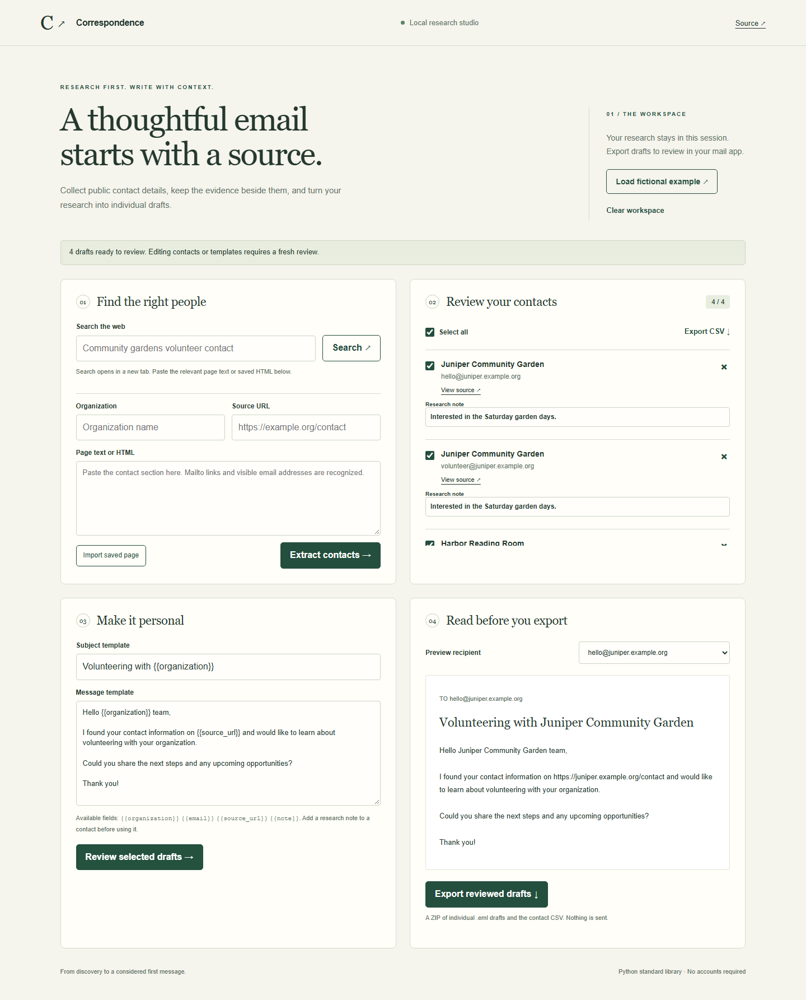

# Correspondence — contact research & draft studio

A local workspace for turning web research into thoughtful, individual email drafts. Start with a source page, review the extracted contacts, personalize the message, and export unsent drafts for your mail client.



## Run in one command

Requires Python 3.10 or newer. The application has **no third-party runtime dependencies**.

```sh
python studio.py
```

Open **http://127.0.0.1:8765** and choose **Load fictional example** for a complete walkthrough. The sample organizations and addresses are fictional and use reserved example.org domains. A different port is available with `python studio.py --port 8800`.

## A complete workflow

1. **Find a source.** Search opens Google in a new tab. Choose a relevant public contact page, then paste its text or import a saved HTML file with its source URL.
2. **Extract and review.** The parser reads visible text and mailto links, recognizes addresses beyond .com/.org, excludes scripts/styles/image assets, and deduplicates addresses. Every contact keeps its source and organization.
3. **Add context.** Write a research note per contact. Templates support `{{organization}}`, `{{email}}`, `{{source_url}}`, and `{{note}}`.
4. **Review every draft.** Unknown or unfilled fields block export. Changing the selection, notes or template invalidates the old review; a late response cannot re-enable an outdated export.
5. **Export.** Download a CSV or a ZIP containing one standards-based `.eml` per recipient plus the source CSV. Unicode subjects and bodies are preserved. `X-Unsent: 1` marks messages as drafts where supported by the email client.

Nothing is sent by this application. It never asks for an email password. Research lives in browser memory and disappears on reload; only explicit downloads persist it. The Python service binds to loopback and serves an allowlist of assets, with same-origin request checks. It does not fetch arbitrary URLs or log contact/message bodies.

## CLI and architecture

The browser and command-line tools use the same extraction, validation and MIME export implementation in `contact_core.py`.

```sh
python subdirectory_finder.py saved-contact-page.html --url https://example.org/contact --organization "Example organization"
python mail.py contacts.json --subject "Hello {{organization}}" --body-file message.txt --output research-drafts.zip
python -m unittest discover -s tests -v
```

`contacts.json` is an array of objects with `email`, `organization`, `source_url`, and `note`. The CLI refuses to replace an existing ZIP. `window.py` is a compatibility launcher for the new studio. `scraper.search_url()` produces a search handoff URL without starting a browser.

- `contact_core.py`: HTML parsing, contact validation, template rendering, CSV and MIME export.
- `studio.py`: dependency-free HTTP adapter, bound to `127.0.0.1`.
- `web/`: responsive, keyboard-accessible research, contact review and draft interface.
- `tests/`: parser and MIME edge cases, import safety, HTTP boundaries and complete browser flows.

Browser regression tests require Node.js 24:

```sh
npm ci
npx playwright install chromium
npm run test:ui
```

## Design choices and limits

This rebuild replaces the original fragile Selenium/Tkinter/SMTP chain with a reviewable workflow. The 2022 implementation remains in Git history; the old artwork and bundled drivers are historical assets and are not used by the current app. Importing a Python module no longer opens a window, reads credentials, crawls sites or sends messages. Search and source selection are an explicit browser handoff rather than an automatic crawl of guessed subdomains.

Extraction is a practical ASCII-email parser, not a deliverability check. It does not resolve obfuscated addresses, internationalized mailboxes, or JavaScript-generated page content absent from the imported file. A matching address is not proof it is the correct contact; check the linked source. Duplicate addresses retain the first source. Maximums are 500 contacts, 500,000 characters per pasted source, and 20,000 characters per template. CSV fields that resemble spreadsheet formulas are escaped on export.

No AI account, email account, search API key or paid service is needed. Existing CC0 license retained.
